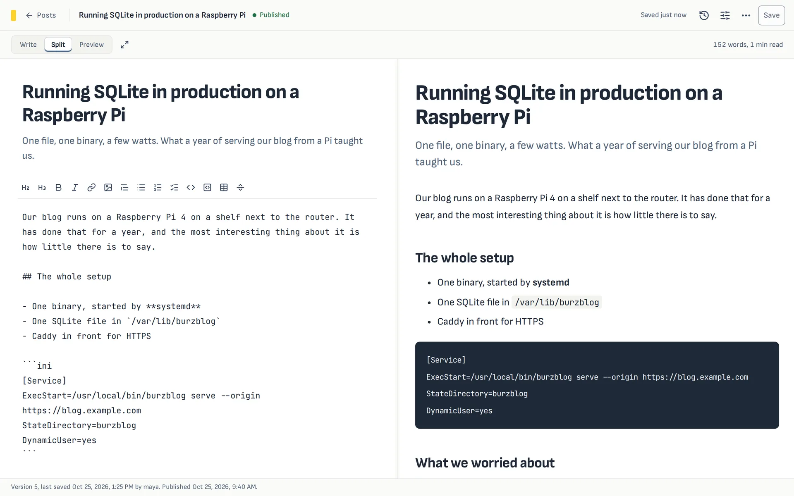

<div align="center">


# BurzBlog

**Write blog posts in the browser or in your own editor.<br>One small binary, one SQLite file, any website.**

[](https://github.com/weburz/burzblog/actions/workflows/check.yml)
[](https://github.com/weburz/burzblog/releases/latest)
[](LICENSE)

[Website](https://burzblog.weburz.com/) · [Install](#install) · [Docs](#docs) · [Releases](https://github.com/weburz/burzblog/releases)

</div>

<picture>
  <source media="(prefers-color-scheme: dark)" srcset="site/assets/editor-dark.webp">
  
</picture>

## Why BurzBlog

- **A writing tool, not a website builder.** BurzBlog is where posts are
  written. Your site, whether Nuxt, Astro, Next or anything else, reads them
  and stays fast, static and up even when BurzBlog is not.
- **Tiny.** One Go binary with the panel built in, about 25 MB of memory at
  rest, and no runtime to install. It runs happily on a Raspberry Pi, and
  dozens of instances fit on one small server.
- **Your editor or ours.** A split Markdown editor in the browser, or
  `burzblog edit my-post` to open the post in `$EDITOR`. Both talk to the same
  server.
- **Nothing gets lost.** Every save is versioned and kept in history. A save
  based on an old version is refused instead of overwriting someone's work.

## Features

| Writing | Publishing | Running it |
|---|---|---|
| Split editor with live preview | Read-only content API with ETags | Single binary, SQLite, no cgo |
| Formatting toolbar and shortcuts | Build-time export as Markdown | Admin and author roles |
| Tags, featured posts, SEO fields | RSS, Atom, JSON Feed, sitemap | Two-factor sign-in (TOTP) |
| Image and PDF uploads | Scheduled publishing | Append-only audit log |
| Full-text search | Redirects for renamed posts | Automatic upgrades of the database |
| Revision history with restore | Deploy hook to rebuild your site | systemd, Docker or Coolify |
| Light and dark themes, phone layout | Custom frontmatter kept as JSON | Encrypted full backups, one command |

## Install

```sh
curl -fsSL https://burzblog.weburz.com/install.sh | sh
```

The script picks the right binary from the
[latest release](https://github.com/weburz/burzblog/releases/latest) and checks
its SHA-256 before installing. Prefer containers? See
[Containers](docs/containers.md).

## Quick start

```sh
burzblog serve --origin https://blog.example.com
```

On a fresh data directory, `serve` prints a one-time setup link
(`/setup#token=…`). Open it to create the first account. Then write from any
computer:

```sh
burzblog login https://blog.example.com
burzblog new "My next post"        # creates a draft and opens $EDITOR
burzblog publish my-next-post
```

Your website reads published posts with a read-only token:

```sh
curl -H "Authorization: Bearer $BURZBLOG_TOKEN" \
  https://blog.example.com/api/content/posts
```

## How it fits together

```text
 browser panel ──┐                       ┌──> content API (JSON, HTML, feeds)
                 ├──> burzblog serve ────┤
 burzblog edit ──┘     + SQLite file     └──> export .md files ──> your site's build
 (your $EDITOR)                                 deploy hook ─────> rebuild on publish
```

## Docs

Also on the website: [burzblog.weburz.com/docs](https://burzblog.weburz.com/docs/).

| Guide | What's inside |
|---|---|
| [Running BurzBlog](docs/self-hosting.md) | systemd, HTTPS with Caddy or nginx, backups, upgrades |
| [Containers](docs/containers.md) | the Docker image, Compose and Coolify |
| [Writing from the terminal](docs/terminal.md) | every command, conflicts, JSON output for scripts |
| [Connecting your website](docs/publishing.md) | content API, export, feeds, deploy hooks |
| [HTTP API](docs/api.md) | every route, plus the stability promise for the content API |
| [Security](docs/security.md) | sign-in, roles, tokens, uploads, the audit log |
| [Architecture](docs/architecture.md) | how the binary, storage and access fit together |

## Development

You need Go 1.27, [Task](https://taskfile.dev/), Node 24 and pnpm 11. Docker
is optional.

```sh
task setup    # Go modules, pnpm dependencies, the Playwright browser
task dev      # API on :8080, panel dev server on :3000
task check    # formatting, linting, Go and panel tests, browser E2E
```

Pull requests run the same checks on GitHub Actions. See
[CONTRIBUTING.md](CONTRIBUTING.md) to get started.

## License

[Apache-2.0](LICENSE)
